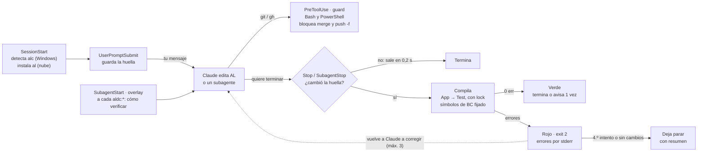
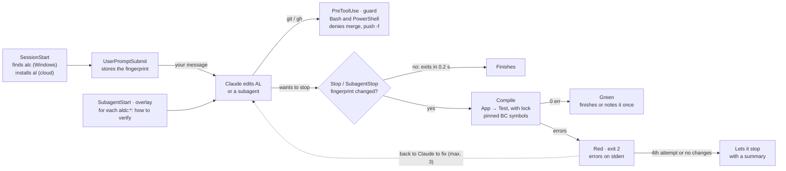

# Guía aldc-verify / aldc-verify guide

[Español](#español) · [English](#english)

---

## Español

**Plugin de Claude Code · v0.3.0**

### aldc-verify: Claude no termina con el AL roto

El plugin compila tus proyectos AL con el compilador real, pasa los analizadores y no deja a Claude cerrar un turno con errores que él mismo ha introducido. Desde la 0.3.0, los agentes también entregan solos: hacen commit, push y abren una PR en borrador, con un guard que les impide mergear o tocar la rama principal.

`L1 compilar · L2 analizadores` · `guard · overlay ALDC` · `probado en BC 27 y BC 28` · `Windows · nube · GitHub Actions`

### Arquitectura: qué pasa en un turno

Hay seis puntos de hook y un solo compilador. La clave es la **huella**: un hash del contenido de los `.al`, los `app.json` y la lista de símbolos. Se toma al empezar el turno y se compara al terminar. Si Claude no ha tocado AL, no se compila nada. Mientras Claude trabaja, el guard revisa cada comando de `git` y `gh`, y el overlay explica a cada subagente de ALDC cómo verificar.



A demanda: `/al-verify` · `al-build-validator` · `/al-go` · `/al-learn` · `/init`. Usan el mismo compilador y el mismo lock; un verde de `/al-verify` evita que el gate recompile. `/al-go` lo lanza Claude: rama `claude/`, push y PR en borrador; nunca mergea.

El gate solo compila si la huella cambió en el turno. Con errores devuelve a Claude a corregir, como mucho 3 veces. Si tras un bloqueo Claude no cambia nada, deja parar enseguida. Si se arregla después de bloquear, le dice a Claude una vez que ya está en verde, para que su respuesta final lo cite. SubagentStop hace lo mismo para los subagentes que escriben código (implement, developer, builder), cada uno con su contador. SubagentStart solo actúa en subagentes `aldc:*`, y el guard solo en repos AL.

### Anatomía: qué pieza hace qué, y dónde vive

Hay dos lados: el plugin, instalado una vez en tu máquina, y la capa fina que `/aldc-verify:init` deja en cada repo. El plugin no guarda nada en el repo salvo su carpeta de estado, que se ignora a sí misma.

**El plugin** (`javiarmesto/aldc-verify-plugin`)

*Automático (hooks)*

- `hooks/hooks.json`: registra seis puntos: SessionStart, UserPromptSubmit, PreToolUse, SubagentStart, SubagentStop y Stop.
- `ensure-al-toolchain.js` (SessionStart): busca `alc` o instala dotnet8 + `al` en la versión fijada. Le recuerda a Claude el flujo con ALDC.
- `al-verify-baseline.js` (UserPromptSubmit): huella del árbol al empezar cada turno. No imprime nada.
- `guard.js` (PreToolUse): para Bash y PowerShell. En repos AL deniega merge, push forzado o a la rama principal, `git add` masivo, `commit -a` y rutas protegidas.
- `aldc-overlay.js` (SubagentStart): a cada subagente `aldc:*` le añade cómo verificar con aldc-verify, según su rol. No toca el plugin `aldc`.
- `al-verify-gate.js` (Stop · SubagentStop): el gate: compara, compila, bloquea o suelta. Lleva el historial en `state.json`.

*A demanda*

- `skills/al-verify`: L1+L2 con resumen corto. Si lo lanzas tú, solo informa.
- `agents/al-build-validator`: compila y agrupa los errores por causa. Solo lectura.
- `skills/al-go`: verifica, revisa, sube versión si el repo lo pide, hace el commit fichero a fichero, el push y la PR en borrador. Lo lanza Claude o tú; no espera a nadie y nunca mergea.
- `skills/al-learn`: propone una línea para el `CLAUDE.md`; la escribe solo si dices que sí.
- `skills/init`: aplica la capa al repo sin pisar nada (dry-run primero).

*Motor común*

- `scripts/lib/al-env.js`: proyectos, orden App → Test, compilador, caché de símbolos filtrada, lock.
- `templates/`: `CLAUDE.md`, `settings.json` y la CI `al-compile.yml`.

**En cada repo** (lo que deja init)

*Versionado*

- `.claude/aldc-verify.json`: la versión de BC objetivo y el compilador fijado: `bcMajor`, `alExtension` (Windows), `alTool` (nube). Aquí también va `guard.protectedPaths`, o `"guard": false` para apagar el guard.
- `.claude/settings.json`: activa el plugin; deniega `git add -A`, `add .`, `commit -a` y `push --force`.
- `CLAUDE.md`: reglas, cómo compilar, warnings conocidos y sección *Aprendido*.
- `.github/workflows/al-compile.yml`: CI en cada PR, solo si el repo versiona los símbolos. Un repo que no los versiona no la tiene.

*Local, ignorado por git*

- `.claude/.aldc-verify/state.json`: último verde, intentos por sesión y subagente, y los últimos 20 eventos (`blocked`, `released`, `green`).
- `last-report.json`: todos los diagnósticos del último `/al-verify`. Los revisores de ALDC lo citan.
- `compile.lock` · `run/`: una compilación a la vez por repo; cada ejecución usa su propia caché.

*De dónde salen los símbolos*

- `.alpackages`: primero el del proyecto; si no hay, `al.packageCachePath` de VS Code y, si no, el del checkout principal (para worktrees). Microsoft: solo la versión mayor de BC fijada.

### Uso diario: qué puedes pedir

| Comando | Quién lo lanza | Qué hace | Efectos |
|---|---|---|---|
| `/aldc-verify:al-verify` | Tú o Claude | Compila y pasa CodeCop, UICop y PerTenantExtensionCop. `--l1` solo compila; `--project test` limita a un proyecto. | ninguno |
| `al-build-validator` | Claude o ALDC | Subagente que compila y devuelve los errores agrupados por causa, con el arreglo propuesto. | ninguno |
| `/aldc-verify:al-go` | Claude, ALDC o tú | Verifica, revisa con BCQuality si está instalado, sube la versión si el repo lo pide, hace el commit fichero a fichero, el push a una rama `claude/…` y abre la PR en borrador. No para a preguntar. Nunca mergea ni marca la PR como lista. | commit · push · PR |
| `/aldc-verify:al-learn` | Tú o Claude | Tras una corrección, propone una regla de una línea para el `CLAUDE.md` del repo. | edita CLAUDE.md si dices sí |
| `/aldc-verify:init` | Solo tú | Aplica la capa a un repo AL nuevo. Primero hace un dry-run y luego te pide confirmar la versión de BC. | crea ficheros |

### Barreras: qué deniega el guard

El guard sustituye la supervisión humana en lo que no tiene vuelta atrás. Solo actúa en repos con algún `app.json`, sobre los comandos de `git` y `gh` que Claude lanza por Bash o PowerShell. Cuando deniega, Claude recibe el motivo y una alternativa. Todo lo demás pasa sin preguntar.

| Comando | Qué le dice a Claude |
|---|---|
| `gh pr merge` | El merge lo decide una persona. Deja la PR abierta e informa. |
| `git push -f`, `--force-with-lease`, `--mirror`, `--delete`, `+ref` | Push forzado o borrado de rama remota. Haz un push normal de una rama `claude/…`. |
| `git push` a `main`, `master`, `dev`, `develop` | Trabaja en una rama `claude/…` y abre una PR. También si haces push sin destino estando en una de esas ramas. |
| `git add -A`, `.`, `--all`, `*` | Añade los ficheros uno a uno por su ruta. |
| `git commit -a` | Añade los ficheros uno a uno y haz commit sin `-a`. |
| `git add` de una ruta protegida | Las carpetas de `guard.protectedPaths` quedan fuera de git. Sirve para datos que nunca deben entrar en git. |

```jsonc
// .claude/aldc-verify.json
{
  "bcMajor": 28,
  "guard": { "protectedPaths": ["data/real-exports"] }
}
// "guard": false  →  apaga el guard en este repo
```

### Con ALDC: cómo encaja con el plugin de ALDC

Desde el 20 de octubre de 2026, el plugin oficial de ALDC para Claude Code es la 5.1.1 (`aldc@aldc-marketplace`). Recomienda aldc-verify y avisa al empezar la sesión si no está instalado. Los hooks de los dos plugins son independientes: ninguno pisa al otro. La 5.1.1 está publicada ([PR #130](https://github.com/javiarmesto/ALDC-AL-Development-Collection/pull/130)). El manual de ALDC está en [esta página](https://claude.ai/artifact/Umr3Mp5Bwi1EocmghH3Dv8).

Lo que une a los dos es el overlay. Cuando arranca un subagente `aldc:*` en un repo AL, aldc-verify le añade unas líneas de contexto según su rol:

| Rol | Subagentes | Qué recibe |
|---|---|---|
| Escriben código | implement, developer, agent-builder | «Compila» se comprueba con `/aldc-verify:al-verify --l1` (o con `al-build-validator`) y se cita el resultado. En TDD, RED es «el test compila y describe el comportamiento». Ejecutar tests necesita un sandbox BC v28+; si no hay, es not-run. |
| Revisan | review, dredd, triage | Citan los errores y warnings reales de `.claude/.aldc-verify/last-report.json` junto a BCQuality. Si falta o es antiguo, escriben «build: not-run». Siguen sin ejecutar nada. |
| Conductor | conductor | Valida cada fase con `al-build-validator` y pega el resultado en el phase-complete. Entrega con `/aldc-verify:al-go`. |
| Planifican | planning, architect, spec, presales | Incluyen la comprobación de «compila» con `/aldc-verify:al-verify` en cada fase del plan. |

### Cómo leerlo: los mensajes que verás

Los mensajes del plugin salen en castellano. Aquí van tal cual.

| Estado | Mensaje | Qué significa |
|---|---|---|
| listo | `aldc-verify: compilador AL listo (alc 18.1…, fijado)` | Al abrir la sesión. Si pone «sin fijar», el repo no tiene `aldc-verify.json`. |
| verde | `aldc-verify: compila (BC 28 …)` | Claude cambió AL y todo compila. |
| bloquea | `la compilación AL falla (intento 1/3)` | Claude no puede terminar; está corrigiendo. |
| deniega | `aldc-verify guard: git add masivo…` | El guard paró un comando. Claude debe cambiar de enfoque, no esquivarlo. |
| suelta | `sigue sin compilar tras 3 intentos` · `no ha cambiado nada tras el bloqueo` | Revisa tú los errores: quedan en el mensaje. |
| not-run | `not-run` · `verificación incompleta` | No se pudo compilar (sin compilador o sin símbolos). No hay nada que dar por bueno. `/al-go` se para aquí y no entrega. |

Los warnings nunca bloquean. Solo bloquean los errores, o una regla que subas a `Error` en un ruleset.

### Empezar: instalar y actualizar

En tu máquina, una vez:

```bash
claude plugin marketplace add javiarmesto/aldc-verify-plugin
claude plugin install aldc-verify@aldc-verify-dev
```

Para pasar a una versión nueva, actualiza el marketplace y el plugin, y reinicia Claude Code:

```bash
claude plugin marketplace update aldc-verify-dev
claude plugin update aldc-verify@aldc-verify-dev
```

En la nube (claude.ai/code), el `.claude/settings.json` del repo no basta. Pon las dos líneas de instalación en el setup script del entorno. Solo se ejecuta en sesiones nuevas. Para probar una copia local sin instalarla: `claude --plugin-dir <ruta>`.

#### Primeros pasos

- [ ] **Instala o actualiza a la 0.3.0.** Esperado: `claude plugin list` muestra `aldc-verify@aldc-verify-dev` en la 0.3.0.
- [ ] **Abre Claude Code en un repo AL.** Esperado: la línea «aldc-verify: compilador AL listo (…)». Si pone «sin fijar», sigue con el paso 3.
- [ ] **Aplica la capa con `/aldc-verify:init`.** Esperado: un dry-run con la versión de BC, los proyectos y el compilador fijado. Confirma la versión antes de aplicar. Solo una vez por repo.
- [ ] **Pide `/aldc-verify:al-verify`.** Esperado: un resumen por proyecto con errores y warnings agrupados por código. No edita nada.
- [ ] **Pide un cambio pequeño de AL.** Esperado: al terminar, «aldc-verify: compila…». Si se le escapa un error, verás «intento 1/3» y Claude lo corrige solo.
- [ ] **Comprueba el guard.** Pide a Claude que haga `git add -A`. Esperado: «aldc-verify guard: git add masivo…» y Claude propone `git add <ruta>`.
- [ ] **Si usas ALDC, delega en `aldc:al-developer`.** Esperado: el subagente cita el resultado de `/al-verify --l1`. Si deja algo roto, SubagentStop lo para antes de devolver el control.
- [ ] **Entrega con `/aldc-verify:al-go`.** Esperado: rama `claude/…`, verify en verde, commits fichero a fichero, push y una PR en borrador. No pregunta y no mergea.
- [ ] **Si algo raro pasa, mira el historial.**

  ```text
  .claude/.aldc-verify/state.json   → history
  set ALDC_VERIFY_DEBUG=1           → trazas del gate
  ```

### Evidencia: qué se ha probado en la 0.3.0

En Windows, el 15 de octubre de 2026. Las pruebas de la 0.2.x (gate, lock, nube, segundo repo) siguen en el README del plugin.

| Caso | Resultado |
|---|---|
| Guard, 21 comandos de ejemplo | 21/21 bien clasificados. |
| `claude -p` que pide `git add -A` y `commit -am` | Denegado. Con Bash y con PowerShell, con el motivo. Claude no lo esquiva y propone `git add <ruta>`. |
| Overlay en `aldc:al-review-subagent` | Recibido. El subagente recibe las instrucciones de evidencia de build. |
| `/al-go` autónomo contra un remoto local | Sin PR. Crea `claude/owner-header`, verifica en verde, hace un commit y el push. No sube versión porque no hay regla. La PR no se abre porque el remoto no es GitHub; deja el texto preparado. |

> **Sin probar todavía:** la apertura real de la PR desde `/al-go` contra GitHub; el aviso de «ya compila en verde» tras un bloqueo, que solo se ha probado simulado; y la CI `al-compile.yml`, que no se ha ejecutado en GitHub Actions.

*aldc-verify 0.3.0 · guía del 20 de octubre de 2026*

---

## English

**Claude Code plugin · v0.3.0**

### aldc-verify: Claude does not finish with broken AL

The plugin compiles your AL projects with the real compiler, runs the analyzers and does not let Claude end a turn with errors it introduced itself. Since 0.3.0, agents also deliver on their own: they commit, push and open a draft PR, with a guard that stops them from merging or touching the main branch.

`L1 compile · L2 analyzers` · `guard · ALDC overlay` · `tested on BC 27 and BC 28` · `Windows · cloud · GitHub Actions`

### Architecture: what happens in a turn

There are six hook points and a single compiler. The key is the **fingerprint**: a hash of the content of the `.al` files, the `app.json` files and the symbol list. It is taken when the turn starts and compared when it ends. If Claude did not touch AL, nothing is compiled. While Claude works, the guard checks every `git` and `gh` command, and the overlay tells each ALDC subagent how to verify.



On demand: `/al-verify` · `al-build-validator` · `/al-go` · `/al-learn` · `/init`. They use the same compiler and the same lock; a green `/al-verify` spares the gate a recompile. Claude can run `/al-go`: `claude/` branch, push, draft PR; it never merges.

The gate only compiles if the fingerprint changed during the turn. With errors it sends Claude back to fix them, at most 3 times. If Claude changes nothing after a block, it lets it stop at once. If the build is fixed after a block, it tells Claude once that it is green, so its final answer can cite it. SubagentStop does the same for subagents that write code (implement, developer, builder), each with its own counter. SubagentStart only acts on `aldc:*` subagents, and the guard only in AL repos.

### Anatomy: which part does what, and where it lives

There are two sides: the plugin, installed once on your machine, and the thin layer that `/aldc-verify:init` leaves in each repo. The plugin stores nothing in the repo except its state folder, which ignores itself.

**The plugin** (`javiarmesto/aldc-verify-plugin`)

*Automatic (hooks)*

- `hooks/hooks.json`: registers six points: SessionStart, UserPromptSubmit, PreToolUse, SubagentStart, SubagentStop and Stop.
- `ensure-al-toolchain.js` (SessionStart): finds `alc` or installs dotnet8 + `al` at the pinned version. Reminds Claude of the ALDC flow.
- `al-verify-baseline.js` (UserPromptSubmit): tree fingerprint at the start of each turn. Prints nothing.
- `guard.js` (PreToolUse): for Bash and PowerShell. In AL repos it denies merges, forced pushes or pushes to the main branch, mass `git add`, `commit -a` and protected paths.
- `aldc-overlay.js` (SubagentStart): adds to each `aldc:*` subagent how to verify with aldc-verify, by role. It does not touch the `aldc` plugin.
- `al-verify-gate.js` (Stop · SubagentStop): the gate: compares, compiles, blocks or releases. Keeps the history in `state.json`.

*On demand*

- `skills/al-verify`: L1+L2 with a short summary. If you run it, it only reports.
- `agents/al-build-validator`: compiles and groups the errors by cause. Read-only.
- `skills/al-go`: verifies, reviews, bumps the version if the repo asks for it, commits file by file, pushes and opens a draft PR. Claude or you can run it; it does not wait for anyone and never merges.
- `skills/al-learn`: proposes one line for `CLAUDE.md`; writes it only if you say yes.
- `skills/init`: applies the layer to the repo without overwriting anything (dry run first).

*Shared engine*

- `scripts/lib/al-env.js`: projects, App → Test order, compiler, filtered symbol cache, lock.
- `templates/`: `CLAUDE.md`, `settings.json` and the `al-compile.yml` CI.

**In each repo** (what init leaves)

*Versioned*

- `.claude/aldc-verify.json`: the target BC version and the pinned compiler: `bcMajor`, `alExtension` (Windows), `alTool` (cloud). It also holds `guard.protectedPaths`, or `"guard": false` to turn the guard off.
- `.claude/settings.json`: enables the plugin; denies `git add -A`, `add .`, `commit -a` and `push --force`.
- `CLAUDE.md`: rules, how to compile, known warnings and a *Learned* (*Aprendido*) section.
- `.github/workflows/al-compile.yml`: CI on each PR, only if the repo versions its symbols. A repo that does not version them has none.

*Local, ignored by git*

- `.claude/.aldc-verify/state.json`: last green, attempts per session and subagent, and the last 20 events (`blocked`, `released`, `green`).
- `last-report.json`: all diagnostics from the last `/al-verify`. ALDC reviewers cite it.
- `compile.lock` · `run/`: one compilation at a time per repo; each run uses its own cache.

*Where symbols come from*

- `.alpackages`: first the project's own; if there is none, VS Code's `al.packageCachePath`, and otherwise the main checkout's (for worktrees). Microsoft: only the pinned BC major version.

### Daily use: what you can ask for

| Command | Who runs it | What it does | Effects |
|---|---|---|---|
| `/aldc-verify:al-verify` | You or Claude | Compiles and runs CodeCop, UICop and PerTenantExtensionCop. `--l1` only compiles; `--project test` limits it to one project. | none |
| `al-build-validator` | Claude or ALDC | Subagent that compiles and returns the errors grouped by cause, with a proposed fix. | none |
| `/aldc-verify:al-go` | Claude, ALDC or you | Verifies, reviews with BCQuality if installed, bumps the version if the repo asks for it, commits file by file, pushes a `claude/…` branch and opens a draft PR. It does not stop to ask. It never merges or marks the PR ready. | commit · push · PR |
| `/aldc-verify:al-learn` | You or Claude | After a correction, proposes a one-line rule for the repo's `CLAUDE.md`. | edits CLAUDE.md if you say yes |
| `/aldc-verify:init` | Only you | Applies the layer to a new AL repo. It first runs a dry run and then asks you to confirm the BC version. | creates files |

### Guardrails: what the guard denies

The guard replaces human supervision for things that cannot be undone. It only acts in repos with an `app.json`, on the `git` and `gh` commands Claude runs through Bash or PowerShell. When it denies a command, Claude gets the reason and an alternative. Everything else goes through without asking.

| Command | What it tells Claude |
|---|---|
| `gh pr merge` | A person decides the merge. Leave the PR open and report. |
| `git push -f`, `--force-with-lease`, `--mirror`, `--delete`, `+ref` | Forced push or remote branch deletion. Do a normal push of a `claude/…` branch. |
| `git push` to `main`, `master`, `dev`, `develop` | Work on a `claude/…` branch and open a PR. This also applies to a push with no target while on one of those branches. |
| `git add -A`, `.`, `--all`, `*` | Add the files one by one by path. |
| `git commit -a` | Add the files one by one and commit without `-a`. |
| `git add` of a protected path | Folders in `guard.protectedPaths` stay out of git. Use it for data that must never be committed. |

```jsonc
// .claude/aldc-verify.json
{
  "bcMajor": 28,
  "guard": { "protectedPaths": ["data/real-exports"] }
}
// "guard": false  →  turns the guard off in this repo
```

### With ALDC: how it fits with the ALDC plugin

Since 20 October 2026, the official ALDC plugin for Claude Code is 5.1.1 (`aldc@aldc-marketplace`). It recommends aldc-verify and warns at session start if it is not installed. The two plugins' hooks are separate: neither overrides the other. 5.1.1 is released ([PR #130](https://github.com/javiarmesto/ALDC-AL-Development-Collection/pull/130)). The ALDC manual is on [this page](https://claude.ai/artifact/Umr3Mp5Bwi1EocmghH3Dv8).

What joins the two is the overlay. When an `aldc:*` subagent starts in an AL repo, aldc-verify adds a few lines of context by role:

| Role | Subagents | What it gets |
|---|---|---|
| Write code | implement, developer, agent-builder | "Compiles" is checked with `/aldc-verify:al-verify --l1` (or with `al-build-validator`) and the result is cited. In TDD, RED means "the test compiles and describes the behaviour". Running tests needs a BC v28+ sandbox; without one it is not-run. |
| Review | review, dredd, triage | They cite the real errors and warnings from `.claude/.aldc-verify/last-report.json` next to BCQuality. If it is missing or old, they write "build: not-run". They still run nothing. |
| Conductor | conductor | Validates each phase with `al-build-validator` and pastes the result into the phase-complete. Delivers with `/aldc-verify:al-go`. |
| Plan | planning, architect, spec, presales | They include the "compiles" check with `/aldc-verify:al-verify` in each phase of the plan. |

### How to read it: the messages you will see

The plugin's messages are in Spanish. They are shown here as they appear.

| State | Message | What it means |
|---|---|---|
| ready | `aldc-verify: compilador AL listo (alc 18.1…, fijado)` | At session start. If it says "sin fijar" (not pinned), the repo has no `aldc-verify.json`. |
| green | `aldc-verify: compila (BC 28 …)` | Claude changed AL and everything compiles. |
| blocks | `la compilación AL falla (intento 1/3)` | Claude cannot finish; it is fixing. |
| denies | `aldc-verify guard: git add masivo…` | The guard stopped a command. Claude must change approach, not work around it. |
| releases | `sigue sin compilar tras 3 intentos` · `no ha cambiado nada tras el bloqueo` | Check the errors yourself: they stay in the message. |
| not-run | `not-run` · `verificación incompleta` | It could not compile (no compiler or no symbols). Nothing can be taken as good. `/al-go` stops here and does not deliver. |

Warnings never block. Only errors block, or a rule you raise to `Error` in a ruleset.

### Getting started: install and update

On your machine, once:

```bash
claude plugin marketplace add javiarmesto/aldc-verify-plugin
claude plugin install aldc-verify@aldc-verify-dev
```

To move to a new version, update the marketplace and the plugin, then restart Claude Code:

```bash
claude plugin marketplace update aldc-verify-dev
claude plugin update aldc-verify@aldc-verify-dev
```

In the cloud (claude.ai/code), the repo's `.claude/settings.json` is not enough. Put the two install lines in the environment's setup script. It only runs in new sessions. To try a local copy without installing it: `claude --plugin-dir <path>`.

#### First steps

- [ ] **Install or update to 0.3.0.** Expected: `claude plugin list` shows `aldc-verify@aldc-verify-dev` at 0.3.0.
- [ ] **Open Claude Code in an AL repo.** Expected: the line "aldc-verify: compilador AL listo (…)". If it says "sin fijar", go on to step 3.
- [ ] **Apply the layer with `/aldc-verify:init`.** Expected: a dry run with the BC version, the projects and the pinned compiler. Confirm the version before applying. Only once per repo.
- [ ] **Ask for `/aldc-verify:al-verify`.** Expected: a summary per project with errors and warnings grouped by code. It edits nothing.
- [ ] **Ask for a small AL change.** Expected: at the end, "aldc-verify: compila…". If an error slips through, you will see "intento 1/3" and Claude fixes it on its own.
- [ ] **Check the guard.** Ask Claude to run `git add -A`. Expected: "aldc-verify guard: git add masivo…" and Claude proposes `git add <path>`.
- [ ] **If you use ALDC, delegate to `aldc:al-developer`.** Expected: the subagent cites the `/al-verify --l1` result. If it leaves something broken, SubagentStop stops it before it hands back control.
- [ ] **Deliver with `/aldc-verify:al-go`.** Expected: a `claude/…` branch, green verify, file-by-file commits, push and a draft PR. It does not ask and does not merge.
- [ ] **If something odd happens, check the history.**

  ```text
  .claude/.aldc-verify/state.json   → history
  set ALDC_VERIFY_DEBUG=1           → gate traces
  ```

### Evidence: what was tested in 0.3.0

On Windows, 15 October 2026. The 0.2.x tests (gate, lock, cloud, second repo) are still in the plugin README.

| Case | Result |
|---|---|
| Guard, 21 sample commands | 21/21 correctly classified. |
| `claude -p` asking for `git add -A` and `commit -am` | Denied. With Bash and with PowerShell, with the reason. Claude does not work around it and proposes `git add <path>`. |
| Overlay on `aldc:al-review-subagent` | Received. The subagent gets the build-evidence instructions. |
| Autonomous `/al-go` against a local remote | No PR. Creates `claude/owner-header`, verifies green, makes a commit and pushes. It does not bump the version because there is no rule. The PR is not opened because the remote is not GitHub; it leaves the text ready. |

> **Not tested yet:** actually opening the PR from `/al-go` against GitHub; the "now green" notice after a block, which has only been tested simulated; and the `al-compile.yml` CI, which has not run on GitHub Actions.

*aldc-verify 0.3.0 · guide of 20 October 2026*
